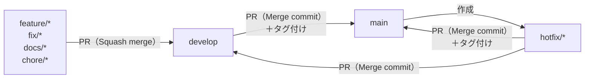
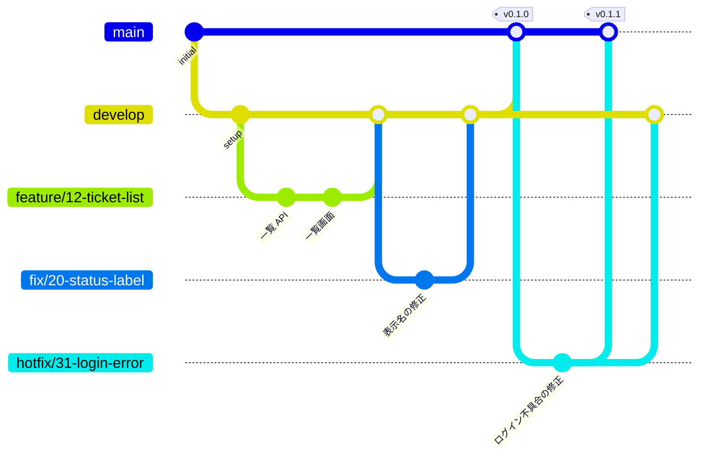

# Novel HELPDESK

社内からの問い合わせをひとつの窓口にまとめる、チケット管理システムです。

- **社員**が困りごとや依頼を「チケット」として起票する
- **サポート担当**がチケットを引き受け、やり取りしながら解決まで進める
- **管理者**がアカウントを管理し、問い合わせ全体の状況をグラフで確認する

質問から解決までのやり取りと対応の経緯がチケットに残るため、誰が何をどこまで対応したかを追えます。

> 業務ルールの詳細は `helpdesk_overview.md`（開発の前提資料）に、画面のイメージは `Novel HELPDESK - Sample.pdf`（画面サンプル）にまとめています。
> これらの資料は**リポジトリには含めていません**。開発に参加する方は担当者から別途受け取り、`private/` フォルダに置いてください（フォルダごと `.gitignore` で除外済みのため、コミットされません）。

## 目次

1. [システム構成](#システム構成)
2. [使用技術](#使用技術)
3. [セットアップ](#セットアップ)
4. [よく使うコマンド](#よく使うコマンド)
5. [Linter / Formatter](#linter--formatter)
6. [CI（自動チェック）](#ci自動チェック)
7. [ブランチ運用ルール](#ブランチ運用ルール)
8. [参考資料](#参考資料)

## システム構成

| 名前 | 役割 | URL（ローカル） |
|---|---|---|
| helpdesk-be | API サーバー | http://localhost:8000/api/v1 |
| helpdesk-fe | Web 画面 | http://localhost:5173 |
| db | MySQL・開発用（Docker） | localhost:3307 |
| db-test | MySQL・テスト用（Docker）。pytest だけが使い、止めるとデータは消える | localhost:3308 |

- 認証は JWT（トークン）で行います
- フロントエンドはバックエンドが起動している前提で動きます

```
helpdesk_tool/
├── README.md
├── docker-compose.yml   # MySQL と BE をまとめて起動
├── .env.example         # 環境変数の見本
├── private/             # 非公開資料（Git 管理外。各自で用意する）
├── helpdesk-be/         # バックエンド（FastAPI）
└── helpdesk-fe/         # フロントエンド（React）
```

## 使用技術

### Backend（helpdesk-be）

| 用途 | 採用技術 |
|---|---|
| 言語 | Python 3.13 |
| フレームワーク | FastAPI |
| ORM | SQLAlchemy v2 |
| マイグレーション | Alembic |
| DB | MySQL 8.0 |
| パッケージ管理 | Poetry |
| 実行環境 | Docker / docker compose |
| Linter / Formatter | Ruff |
| テスト | pytest（テスト用 DB は Docker で起動） |

### Frontend（helpdesk-fe）

| 用途 | 採用技術 |
|---|---|
| 言語 | TypeScript |
| フレームワーク | React 19 + Vite |
| UI ライブラリ | Chakra UI v3 |
| サーバー状態管理 | TanStack React Query v5 |
| HTTP クライアント | Axios |
| ルーティング | React Router v7 |
| グラフ描画 | Recharts |
| Linter / Formatter | ESLint / Prettier |
| テスト | Vitest + React Testing Library、E2E は Playwright |
| パッケージ管理 | yarn |

画面は **Container**（データ取得・ロジック）と **Presentational**（表示のみ）に分けて実装します。

## セットアップ

### 開発に必要なもの

- Docker / Docker Compose
- Python 3.13、Poetry
- Node.js 26、yarn（Node.js のバージョンは `helpdesk-fe/.nvmrc` で指定。22.22.2 以上の 22 系・24.15 以上の 24 系でも動作しますが、23・25 系やそれより古いバージョンでは `yarn install` が失敗します）

### 1. 前提資料を受け取る

担当者から次の資料を受け取り、`private/` フォルダ（なければ作成）に置きます。このフォルダは Git の管理外です。

- `helpdesk_overview.md`（開発の前提資料）
- `Novel HELPDESK - Sample.pdf`（画面サンプル）

### 2. 環境変数を用意する

```bash
cp .env.example .env
```

**セキュリティのため、`.env` の `MYSQL_ROOT_PASSWORD` と `MYSQL_PASSWORD` は必ず変更してください。** `.env.example` の値（`change-me` など）は公開されている見本の値です。

```bash
# ランダムな値の作り方の例（出力された値を .env に貼り付ける）
openssl rand -hex 16
```

> **注意**：パスワードに **`$` は使わないでください**。docker compose は `.env` の `$` を変数の印として扱いますが、ホストで直接動かすコマンド（`poetry run alembic` など）は `.env` をそのまま読むため、両者でパスワードが食い違い、DB に接続できなくなります。`@` `%` `/` `#` `:` などの他の記号は使えます。

> **注意**：パスワードの変更は、**最初の `docker compose up` より前**に行ってください。MySQL は初回起動時の値で DB を作るため、起動後に `.env` を変えても DB には反映されず、API が DB に接続できなくなります。
> 起動後に変更したい場合は、`docker compose down -v`（開発用 DB のデータも削除されます）を実行してから起動し直してください。

### 3. Backend を起動する（DB と API を Docker で起動）

```bash
docker compose up -d --build
```

- 動作確認：http://localhost:8000/api/v1/health
- API ドキュメント（Swagger UI）：http://localhost:8000/docs
- MySQL はホストの **3307** 番（開発用）と **3308** 番（テスト用）で公開しています（ローカルの MySQL との衝突を避けるため）
- 起動するコンテナは `db`（開発用 DB）、`db-test`（テスト用 DB）、`be`（API）の 3 つです

エディタの補完用に、ホストにも仮想環境を作っておきます。

```bash
cd helpdesk-be
poetry env use python3.13
poetry install   # helpdesk-be/.venv に作られる（設定は helpdesk-be/poetry.toml に記載済み）
```

### 4. Frontend を起動する

```bash
cd helpdesk-fe
yarn install
yarn dev
```

http://localhost:5173 を開き、「API: 接続OK」と表示されればセットアップ完了です。

## よく使うコマンド

| 用途 | コマンド | 実行場所 |
|---|---|---|
| BE・DB の起動 / 停止 | `docker compose up -d` / `docker compose down` | リポジトリ直下 |
| BE のテスト（テスト用 DB を使用） | `docker compose exec be pytest` | リポジトリ直下 |
| BE の本番用イメージ作成（本番用パッケージのみ） | `docker build --target prod -t helpdesk-be:prod ./helpdesk-be` | リポジトリ直下 |
| マイグレーション作成 | `poetry run alembic revision --autogenerate -m "内容"` | helpdesk-be |
| マイグレーション適用 | `poetry run alembic upgrade head` | helpdesk-be |
| BE の Lint（問題の検出 / 自動修正） | `make lint` / `make lint-fix` | helpdesk-be |
| BE の書式（確認 / 自動修正） | `make format-check` / `make format-fix` | helpdesk-be |
| FE の開発サーバー | `yarn dev` | helpdesk-fe |
| FE のビルド（型チェック含む） | `yarn build` | helpdesk-fe |
| FE のテスト | `yarn test` | helpdesk-fe |
| E2E テスト（BE を起動した状態で実行） | `yarn test:e2e`（初回のみ `yarn playwright install chromium`） | helpdesk-fe |
| FE の Lint（問題の検出 / 自動修正） | `yarn lint` / `yarn lint:fix` | helpdesk-fe |
| FE の書式（確認 / 自動修正） | `yarn format:check` / `yarn format:fix` | helpdesk-fe |

## Linter / Formatter

### Backend（Ruff）

| ツール | 役割 | 設定ファイル |
|---|---|---|
| Ruff | コードの問題を見つける（未使用の import・変数、よくあるバグのパターン、import の並び順など）と、書式を自動でそろえる | `helpdesk-be/pyproject.toml`（`[tool.ruff]`） |

#### コマンドで実行する

`helpdesk-be` で実行します（事前に、セットアップの手順でホストの仮想環境を作成し `poetry install` しておく必要があります）。

```bash
make lint          # 問題を検出する（問題があればエラー終了＝終了コード 0 以外）
make lint-fix      # 自動で直せる問題を直す
make format-check  # 書式がそろっているか確認する（ずれがあればエラー終了＝終了コード 0 以外）
make format-fix    # 書式を自動でそろえる
make help          # コマンドの一覧を表示する
```

`make lint-fix` で直らない指摘（未使用の変数など）は、メッセージに従って手で直してください。

コンテナの中で実行することもできます（リポジトリ直下で実行）。

```bash
docker compose exec be ruff check .
docker compose exec be ruff format --check .
```

#### VS Code で使う

1. このリポジトリ（`helpdesk_tool`）を VS Code で開く
2. 「推奨拡張機能」から、Ruff（`charliermarsh.ruff`）をインストールする
3. インストール後、コマンドパレット（`Cmd + Shift + P`）で「Developer: Reload Window」を実行する

設定は `.vscode/settings.json` に入っているため、追加の設定は不要です（Python の仮想環境として `helpdesk-be/.venv` を使います）。

- Ruff の指摘が、エディタ上に波線で表示され、「問題」パネルにも一覧で表示されます
- ファイルを保存すると、Ruff で書式がそろい、自動で直せる問題と import の並び順が直ります

### Frontend（ESLint / Prettier）

| ツール | 役割 | 設定ファイル |
|---|---|---|
| ESLint | コードの問題を見つける（未使用の変数、React のフックの誤った使い方など） | `helpdesk-fe/eslint.config.js` |
| Prettier | 書式を自動でそろえる（引用符、セミコロン、改行など） | `helpdesk-fe/.prettierrc.json` |

書式に関するルールは Prettier に任せ、ESLint 側では無効にしています（`eslint-config-prettier`）。両方を実行しても指摘がぶつかりません。

#### コマンドで実行する

`helpdesk-fe` で実行します（事前に `yarn install` が必要です）。

```bash
yarn lint          # 問題を検出する（問題があれば終了コード 1）
yarn lint:fix      # 自動で直せる問題を直す
yarn format:check  # 書式がそろっているか確認する（ずれがあれば終了コード 1）
yarn format:fix    # 書式を自動でそろえる
```

`yarn lint:fix` で直らない指摘（未使用の変数、フックの呼び出し位置など）は、メッセージに従って手で直してください。

#### VS Code で使う

1. このリポジトリ（`helpdesk_tool`）を VS Code で開く
2. 右下に表示される「推奨拡張機能」から、次の 2 つをインストールする（拡張機能の画面で `@recommended` と検索しても表示されます）
   - ESLint（`dbaeumer.vscode-eslint`）
   - Prettier - Code formatter（`esbenp.prettier-vscode`）
3. インストール後、コマンドパレット（`Cmd + Shift + P`）で「Developer: Reload Window」を実行する

設定は `.vscode/settings.json` に入っているため、追加の設定は不要です。

- ESLint の指摘が、エディタ上に波線で表示され、「問題」パネルにも一覧で表示されます
- ファイルを保存すると、Prettier で書式がそろい、ESLint で自動修正できる問題が直ります

### VS Code でうまく動かないとき（Backend / Frontend 共通）

- **拡張機能が無効になっていないか**：拡張機能の画面で Ruff / ESLint / Prettier を開き、「無効」になっていたら「有効にする」の横の ▼ から「有効にする（ワークスペース）」を選ぶ（このプロジェクトだけで有効になります）
- **`Cmd + S` で保存しているか**：VS Code の自動保存（`files.autoSave`）では整形は動きません
- 整形の設定（文字数など）は各プロジェクトの設定ファイル（`helpdesk-be/pyproject.toml`、`helpdesk-fe/.prettierrc.json`）が優先されるため、VS Code の個人設定の値は使われません
- **（Backend）Ruff の指摘が出ないとき**：`helpdesk-be/.venv` が作られているか確認する（セットアップの「3. Backend を起動する」の手順）。コマンドパレットの「Python: Select Interpreter」で `helpdesk-be/.venv` を選ぶ

## CI（自動チェック）

GitHub Actions で、ブランチへの push と PR のたびに Lint・書式・テストを自動で実行します（タグの push では実行しません）。

結果は PR 画面に表示されます。`develop` と `main` のブランチ保護で必須チェックに設定すると、**どれか 1 つでも失敗した PR はマージできなくなります**（設定内容は「[GitHub の推奨設定](#github-の推奨設定)」を参照）。

### Backend（helpdesk-be）

設定ファイル：`.github/workflows/be-ci.yml`（PR 画面での表示名は `BE CI`）

| チェック | 内容 | ローカルで同じことをするコマンド（helpdesk-be で実行） |
|---|---|---|
| `be-lint` | Ruff で問題を検出する | `make lint` |
| `be-format` | Ruff で書式がそろっているか確認する | `make format-check` |
| `be-test` | pytest で単体テストを実行する（CI 上でテスト用の MySQL を起動する） | `docker compose exec be pytest`（リポジトリ直下で実行） |
| `be-result` | 上の 3 つ（と、変更の判定 `be-changes`）の結果をまとめ、失敗・中断があれば失敗にする | － |

- `helpdesk-be/` に変更がない push・PR（FE だけの変更など）では、`be-lint` / `be-format` / `be-test` はスキップされます。スキップは「成功」扱いのため、マージは止まりません
  - PR では、マージ先のブランチとの差分で判定します
  - push では、`develop` から分かれた後の変更で判定します（`develop` 自身への push は、push の直前との差分）
- `be-result` は、変更の判定（`be-changes`）が失敗したときに、検査がスキップされたままマージされるのを防ぐためのチェックです
- CI の MySQL は CI 専用の使い捨てです。ワークフローに書いてあるパスワードは CI でしか使わないため、公開されていても問題ありません
- CI の MySQL の文字コードと照合順序（`utf8mb4` / `utf8mb4_unicode_ci`）は、`docker-compose.yml` の `db-test` とそろえています

### 結果の見方と、失敗したとき

1. PR 画面の下部（Checks）に、チェックごとの結果（✅ / ❌）が表示されます
2. ❌ の横の「Details」を開くと、どこで失敗したかのログが見られます（Lint の指摘は、PR の「Files changed」のコード上にも表示されます）
3. 上の表のコマンドをローカルで実行して直し、もう一度 push すると、CI が自動で再実行されます

書式の失敗は `make format-fix`、Lint の失敗の多くは `make lint-fix` で直せます。

## ブランチ運用ルール

`main` と `develop` の 2 本を常設し、作業はすべて作業用ブランチで行います。作業用ブランチはプルリクエスト（PR）でマージします。

### ブランチの種類

| ブランチ | 概要 | 作成元 | マージ先 | 寿命 |
|---|---|---|---|---|
| `main` | リリースできる状態のコード。常に動く状態を保つ | － | － | 常設 |
| `develop` | 開発中の機能を統合するブランチ。次のリリースの候補 | `main` | `main` | 常設 |
| `feature/*` | 新機能の追加 | `develop` | `develop` | マージ後に削除 |
| `fix/*` | `develop` 上で見つかった不具合の修正 | `develop` | `develop` | マージ後に削除 |
| `hotfix/*` | `main`（リリース済み）の緊急修正 | `main` | `main` と `develop` | マージ後に削除 |
| `docs/*` | README などドキュメントだけの変更 | `develop` | `develop` | マージ後に削除 |
| `chore/*` | 設定・依存パッケージの更新など、機能に影響しない変更 | `develop` | `develop` | マージ後に削除 |

### ブランチ名の命名規則

```
<種類>/<タスク番号>-<短い説明>
```

| 要素 | ルール | 例 |
|---|---|---|
| 種類 | `feature` / `fix` / `hotfix` / `docs` / `chore` のいずれか | `feature` |
| タスク番号 | GitHub Issue の番号。番号がない作業は省略してよい | `12` |
| 短い説明 | 英小文字・数字・ハイフンのみ。内容がわかる 2〜5 語程度 | `ticket-list` |

- 全体で 50 文字以内にする
- 日本語、大文字、スペース、アンダースコア（`_`）は使わない

| 良い例 | 悪い例 | 理由 |
|---|---|---|
| `feature/12-ticket-list` | `feature/チケット一覧` | 日本語は使わない |
| `fix/20-status-label` | `Fix/20_Status_Label` | 大文字・アンダースコアは使わない |
| `hotfix/31-login-error` | `hotfix/fix` | 何の修正かわからない |
| `docs/update-readme` | `my-work` | 種類がない、作業内容がわからない |

### マージ・被マージの流れ



| マージする側 | マージされる側 | 方法 | 補足 |
|---|---|---|---|
| `feature/*` `fix/*` `docs/*` `chore/*` | `develop` | Squash merge | 1 タスク = 1 コミットにまとまる |
| `develop` | `main` | Merge commit | マージ後にタグを付ける |
| `hotfix/*` | `main` | Merge commit | マージ後にタグを付ける |
| `hotfix/*` | `develop` | Merge commit | `main` と `develop` の差を作らないため、必ず両方に入れる |

時間の流れで見ると、次のようになります。



### 使用時のルール

#### main

- 直接コミット・直接 push はしない。`develop` または `hotfix/*` からの PR でのみ更新する
- マージしたらリリース番号のタグを付ける（例：`v0.1.0`）
- マージ方法は **Merge commit**（履歴をまとめずに残す）

#### develop

- 直接コミット・直接 push はしない。作業用ブランチからの PR でのみ更新する
- 常にビルドとテストが通る状態を保つ
- 区切りのよいところ（機能のまとまりができたとき）で `main` への PR を作る

#### 作業用ブランチ（feature / fix / hotfix / docs / chore）

- 作る前に作成元のブランチを最新にする
- 自分のブランチは何度コミットしてもよい。PR を出す前に作成元の最新を取り込む
- PR を出す条件
  - BE のテスト（`docker compose exec be pytest`）が通っている
  - FE のビルドとテスト（`yarn build` / `yarn test`）が通っている
  - PR の説明に「何をしたか」「どう確認したか」を書いている
- マージ方法はブランチの種類で異なる
  - `feature/*` `fix/*` `docs/*` `chore/*` → `develop`：**Squash merge**（1 つの PR が `develop` 上で 1 コミットになる）
  - `hotfix/*` → `main` / `develop`：**Merge commit**（`main` と `develop` に同じコミットを入れ、両者の差を作らないため）
- マージしたらブランチを削除する

### タスクに対する使用の仕方

**1 タスク = 1 ブランチ = 1 PR** を基本にします。

```bash
# 1. 作成元を最新にする
git switch develop
git pull

# 2. タスク用のブランチを作る
git switch -c feature/12-ticket-list

# 3. 作業してコミットする（何回でもよい）
git add .
git commit -m "チケット一覧 API を追加"

# 4. PR の前に develop の最新を取り込む
git fetch origin
git rebase origin/develop

# 5. push して PR を作る（マージ先は develop）
git push -u origin feature/12-ticket-list
gh pr create --base develop
```

> **すでに push 済みのブランチで 4 の rebase をした場合**、`git push` はエラーになります（rebase でコミットが作り直され、リモートと履歴が食い違うため）。そのときは `git push --force-with-lease` で push してください。

- タスクが大きい場合（目安：PR の差分が 500 行を超えそう、または 3 日以上かかりそう）は、タスクを分けてブランチも分ける
- BE と FE の両方にまたがるタスクは、同じブランチでまとめて PR にしてよい（1 つのリポジトリで管理しているため）
- 作業中に別の不具合を見つけたら、今のブランチでは直さず、別のタスク・別のブランチにする

### 禁止事項

- `main` と `develop` への直接コミット・直接 push
- `main` と `develop` への force push（`git push --force`）
- 1 つのブランチに複数のタスクを混ぜること
- 他の人のブランチに、本人の了承なく push すること
- テストやビルドが失敗したままのマージ
- 秘密情報（`.env`、パスワード、API キーなど）や非公開資料（`helpdesk_overview.md`、`Novel HELPDESK - Sample.pdf`）のコミット
- マージ済みのブランチを再利用して、別の作業を続けること

### 例外

| ケース | 扱い |
|---|---|
| リポジトリの最初のコミット | `main` に直接コミットし、そこから `develop` を作成する |
| 自分専用の作業用ブランチでの force push | `git rebase` 後に限り `git push --force-with-lease` を使ってよい |
| リリース済みの環境で緊急の不具合 | `develop` を経由せず、`main` から `hotfix/*` を作る |

### GitHub の推奨設定

ルールを守りやすくするため、`main` と `develop` にブランチ保護（Settings → Branches）を設定します。

- 直接 push を禁止し、PR を必須にする（Require a pull request before merging）
- CI の成功をマージの条件にする（Require status checks to pass before merging）。必須にするチェックは `be-lint` / `be-format` / `be-test` / `be-result`
- force push と削除を禁止する
- マージ後に作業用ブランチを自動で削除する（Settings → General → Automatically delete head branches）

## 参考資料

- `helpdesk_overview.md`：開発の前提と業務ルール（非公開。担当者から別途受領）
- `Novel HELPDESK - Sample.pdf`：画面のイメージ（非公開。担当者から別途受領）
